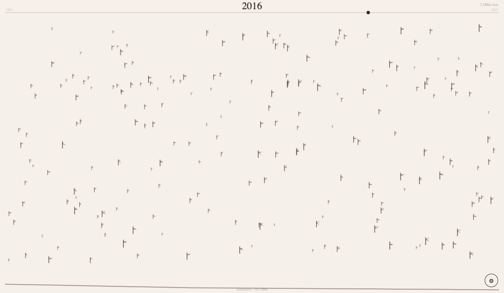
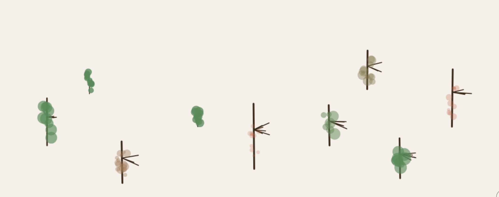

<div align="center">

<h1>Grow</h1>

<p><b>A forest that replays 35 years of forest data.</b></p>

<p><i>One second per year, 1991 to 2025: the world's net change in forest area, planted as trees on cream paper.</i></p>

<h6>


</h6>

<a href="https://parthchandak02.github.io/grow/"><b>Live demo</b></a> ·
<a href="#how-it-works"><b>How it works</b></a> ·
<a href="#plant-your-own"><b>Plant your own</b></a> ·
<a href="#run-it"><b>Run it</b></a>

<br><br>

<a href="https://parthchandak02.github.io/grow/"></a>

<sub>Timeline mode, live capture after 26 seconds. Real FAO data.</sub>

</div>

<br>

Grow started as a click-to-plant garden and became a small data piece. Switch it to Timeline
and it walks through the FAO's world figures for annual net change in forest area, 1991 to
2025, one year per second. Each year scatters a handful of small trees across the page, sized by
how many hectares changed, and the trees stay, so the page fills up the way the losses add up.
A line along the bottom tracks the running total. Then it loops.

## How it works

| Data (World, `deforestation_data.csv`) | Drives |
|---|---|
| Year | The big serif year at the top and the dot on the progress bar |
| Hectares changed that year | Trees planted: one per 500,000 ha, between 2 and 10 a year |
| Sign of the change | Whether the new trees are drawn with a green canopy or as bare brown trunks |
| Running total since 1991 | The line along the bottom, and the `cumulative` figure under it |

The CSV is Our World in Data's export of *Annual change in forest area* from the FAO Global
Forest Resources Assessment 2025. The page fetches it from this repo's `main` branch on
GitHub; if that fails it falls back to random values and says so in the top-left corner. The FAO series is a five- or ten-year
average, so consecutive years often repeat the same number.

In this dataset a negative value is a net loss. Every world value from 1991 to 2025 is negative
(about 3.2 to 10.7 million ha a year), so the timeline plants bare brown trunks and the top-right
label reads "lost".

## Plant your own

<div align="center">



<sub>Manual mode with nine trees at different ages and the Size slider raised.</sub>

</div>

Manual mode is the default. Click or tap anywhere to plant a tree, up to 30 at once. Each one
grows in, sways, turns from sage to terracotta as it ages, drops its leaves and disappears.
The gear button bottom-right opens the controls: the Timeline / Manual switch, and in Manual,
sliders for growth speed, lifespan (5 to 25 seconds), size and sway.

## Run it

```bash
git clone https://github.com/parthchandak02/grow.git
cd grow
python3 -m http.server 8000   # then open http://localhost:8000
```

One HTML file with no build step and no libraries. Opening `index.html` directly also works.

<details>
<summary><b>Files</b></summary>

```
index.html                     The whole piece: canvas, controls, both modes
deforestation_data.csv         FAO annual change in forest area by country, 1991-2025 (used)
deforestation_metadata.json    Source and citation for that CSV
```

</details>

<details>
<summary><b>The generative series</b></summary>

Grow is one of a set of daily generative builds:
[tessellate](https://parthchandak02.github.io/tessellate/) ·
[flora](https://parthchandak02.github.io/flora/) ·
[grow](https://parthchandak02.github.io/grow/) ·
[drift](https://parthchandak02.github.io/drift/) ·
[trace](https://parthchandak02.github.io/trace/) ·
[resonate](https://parthchandak02.github.io/resonate/) ·
[swell](https://parthchandak02.github.io/swell/) ·
[flux](https://parthchandak02.github.io/flux/)

</details>

<br>

<div align="center">
<sub>Built with Canvas 2D in a single HTML file. Data from the FAO Global Forest Resources Assessment 2025, via Our World in Data.</sub>
</div>
